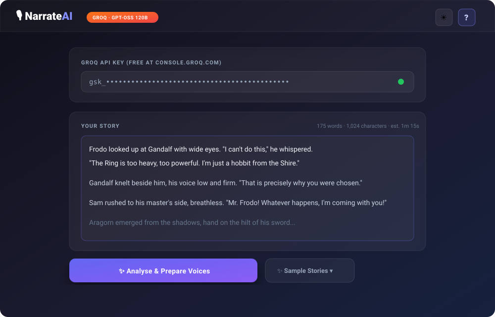
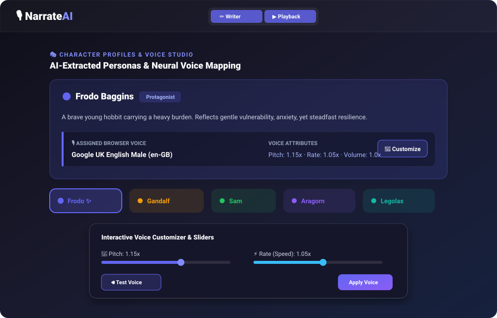
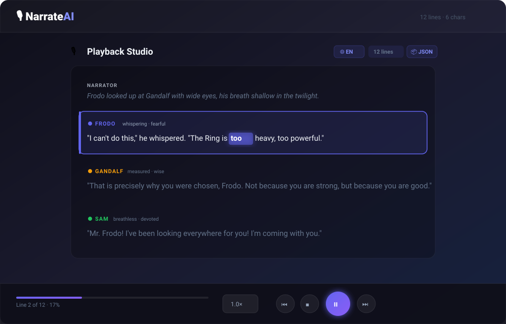

# 🎙️ NarrateAI

### AI-Powered Multi-Voice Audiobook Engine

[](https://github.com/PSIT-GDGOC/narrate-ai)
[](https://react.dev)
[](https://vitejs.dev)
[](https://groq.com)
[](https://narrate-ai-gamma.vercel.app)
[](LICENSE)

---

## 🎃 Welcome Hacktoberfest Contributors!

NarrateAI is proud to be part of the **GDGOC PSIT Hacktoberfest** programme! We welcome contributions from developers of all skill levels. Whether you are fixing typos, improving UI/UX accessibility, adding unit tests, or implementing new AI features, there is an issue waiting for you.

### 🏆 Points & Difficulty Tiers
Issues are categorized and tracked by our automated webhook:

| Difficulty | Label | Points | Description |
|---|---|---|---|
| **Easy** | `easy` | **20 pts** | Documentation, UI tweaks, sample stories, accessibility |
| **Medium** | `medium` | **40 pts** | Audio chunking, component refactoring, test suites, exports |
| **Hard** | `hard` | **80 pts** | Browser extension, multi-language speech, backend integration |

---

## 📖 What is NarrateAI?

**NarrateAI** is a web application that transforms raw story text into an immersive multi-voice audiobook experience. It uses AI to analyze stories, detect distinct characters and unspoken thoughts, extract emotions, and direct the browser's native speech synthesis engine (Web Speech API) with customized pitch, rate, and vocal personas.

### ✨ Key Features

| Feature | Description |
|---|---|
| 🤖 **AI-Powered Analysis** | Uses Groq's Llama 3.3 70B to identify characters, emotions, and voice profiles |
| 🎭 **Distinct Character Voices** | Each character gets a unique voice based on their persona (gender, age, personality) |
| 😊 **Emotion-Driven Speech** | Pitch, rate, and volume adjust dynamically based on character emotions (happy, sad, angry, fearful, etc.) |
| ⏯️ **Full Playback Controls** | Play, pause, stop, skip forward/backward, and adjustable speed (0.75× to 1.5×) |
| 📱 **Responsive Design** | Modern, dark-themed UI that works on desktop, tablet, and mobile browsers |
| 💾 **Local Storage** | Automatically persists your API key, story text, and playback state |
| 🕒 **History Panel** | Fast access to re-listen to your last 5 analyzed stories |
| 🎨 **Visual Character Panel** | Inspect character profiles, emotional traits, and their assigned browser voices |
| 🔍 **Line-by-Line Highlighting** | Active line is highlighted and auto-scrolls during narration |
| ⌨️ **Keyboard Shortcuts** | `Space` (play/pause), `R` (reset), Arrow keys (skip lines) |

---

## 🚀 Live Demo

Experience NarrateAI in action: **[https://narrate-ai-gamma.vercel.app](https://narrate-ai-gamma.vercel.app)**

---

## 🏗️ Architecture

```
┌─────────────────────────────────────────────────────────────────┐
│                        User's Browser                           │
│  ┌───────────────────────────────────────────────────────────┐  │
│  │                  NarrateAI React App                      │  │
│  │  ┌─────────────┐  ┌─────────────┐  ┌─────────────────┐    │  |
│  │  │  API Key    │  │   Story     │  │  Voice Analysis │    │  |
│  │  │    Input    │  │   Input     │  │  & Playback     │    │  |
│  │  └─────────────┘  └─────────────┘  └─────────────────┘    │  |
│  └───────────────────────────────────────────────────────────┘  │
└─────────────────────────────────────────────────────────────────┘
                               │
                               ▼
┌─────────────────────────────────────────────────────────────────┐
│                         Groq API                                │
│  ┌───────────────────────────────────────────────────────────┐  │
│  │              Llama 3.3 70B (Fast inference)               │  │
│  │   • Characters    • Inner Thoughts    • Emotions          │  │
│  │   • Voice Profile (pitch, rate)      • Persona tags       │  │
│  └───────────────────────────────────────────────────────────┘  │
└─────────────────────────────────────────────────────────────────┘
                               │
                               ▼
┌─────────────────────────────────────────────────────────────────┐
│                  Browser Web Speech API                         │
│  ┌───────────────────────────────────────────────────────────┐  │
│  │  • Assigns best matching browser TTS voice per character  │  │
│  │  • Applies dynamic pitch, rate & volume modulation        │  │
│  │  • Real-time speech synthesis directly in browser         │  │
│  └───────────────────────────────────────────────────────────┘  │
└─────────────────────────────────────────────────────────────────┘
```

> **Note on Backend**: The core web app runs entirely client-side without requiring a server. An optional FastAPI server is included in the `backend/` directory for optional proxying or centralized API access.

---

## 🛠️ Tech Stack

- **Frontend**: React 19, Vite, Vanilla CSS
- **Audio & Speech**: Browser Native Web Speech API (`window.speechSynthesis`)
- **AI Inference**: Groq Cloud API (`llama-3.3-70b-versatile`)
- **Backend (Optional)**: FastAPI, Python 3.10+, Uvicorn

---

## 📦 Installation & Setup

### Prerequisites
- [Node.js](https://nodejs.org/) (v18 or higher recommended)
- `npm` or `yarn`
- A free Groq API key from [console.groq.com/keys](https://console.groq.com/keys)

### Local Development Steps

1. **Fork and Clone the Repository**
   ```bash
   git clone https://github.com/<your-username>/narrate-ai.git
   cd narrate-ai
   ```

2. **Install Dependencies**
   ```bash
   npm install
   ```

3. **Start Development Server**
   ```bash
   npm run dev
   ```
   Open `http://localhost:5173` in your browser.

4. **Verify Code Quality**
   ```bash
   npm run lint
   npm run build
   ```

---

## 🎯 Visual Walkthrough & Usage Guide

### 1. Enter Groq API Key & Story Text
Get a free API key at [console.groq.com/keys](https://console.groq.com/keys) and paste it into the API key input (securely stored in your browser's `localStorage`). Paste your narrative scene or choose one from the **Sample Stories** selector (Fantasy, Sci-Fi, Mystery).



### 2. AI Character Extraction & Voice Studio
Click **"✨ Analyse & Prepare Voices"**. NarrateAI directs Groq's high-speed inference to analyze the narrative, extract character personas and emotional states, and match appropriate browser speech voices. You can click on any character card to inspect traits or open the **Voice Customizer** to adjust pitch and rate.



### 3. Interactive Playback Studio & Karaoke Highlighting
Click **"▶ Play"** to enjoy your story! NarrateAI delivers an immersive audiobook experience with synchronized line and karaoke word highlighting, dynamic emotional modulation, speed adjustment (0.75× – 1.5×), keyboard shortcuts, and JSON / Markdown script exports.



---

## 🧩 Browser Extension (Manifest V3)

NarrateAI includes a Chrome Manifest V3 extension that enables one-click narration for highlighted text across any webpage (news articles, blogs, stories).

### ✨ Extension Features
- 🖱️ **Context Menu**: Highlight text on any page, right-click, and choose **"Narrate with NarrateAI"**.
- 🎧 **Built-in Quick Player**: Fast playback in the extension popup with Play, Pause, Stop, and speed rate controls (0.5× to 2.0×).
- 🚀 **One-Click Studio Launch**: Seamlessly passes the captured story to the NarrateAI web application for dynamic character extraction and emotional multi-voice synthesis.
- 📋 **Grab Highlighted**: Extract active webpage selections directly into the popup with a single click.

### 🛠️ Loading the Unpacked Extension in Chrome Developer Mode
1. Open Google Chrome and navigate to `chrome://extensions/`.
2. Enable **Developer mode** using the toggle switch in the top-right corner.
3. Click the **Load unpacked** button in the top-left toolbar.
4. Browse and select the `extension/` directory in this repository (`narrate-ai/extension`).
5. Pin **NarrateAI** from Chrome's extensions toolbar menu for quick access.


## 🤝 Contribution Guidelines (GDGOC Hacktoberfest)

We love contributions! Please follow this workflow to ensure your pull request is tracked and credited:

### 1. Claiming an Issue
1. Browse the open issues labeled `hacktoberfest`.
2. **Claim the issue on the Hacktoberfest portal first** before starting work.
3. Each issue has a claim timer (~48 hours). Please only claim an issue if you intend to work on it immediately.

### 2. Working on Your Changes
1. Fork `PSIT-GDGOC/narrate-ai` to your personal GitHub account.
2. Clone your fork locally and create a dedicated branch:
   ```bash
   git checkout -b fix-issue-<issue-number>
   ```
3. Make your changes adhering to clean code standards.
4. Test thoroughly and ensure build and lint checks pass:
   ```bash
   npm run lint
   npm run build
   ```

### 3. Submitting Your Pull Request
1. Push your branch to your fork:
   ```bash
   git push origin fix-issue-<issue-number>
   ```
2. Open a Pull Request targeting the `main` branch of `PSIT-GDGOC/narrate-ai`.
3. **MANDATORY**: In your PR description, include:
   ```markdown
   Fixes #<issue-number>
   ```
   *(e.g., `Fixes #12`). Our tracking webhook relies on this keyword to link and credit your PR.*
4. Link screenshots or GIFs for UI-related changes.
5. Keep each PR focused on a single issue.

---

## 📄 License

This project is licensed under the MIT License – see the [LICENSE](LICENSE) file for details.

---

## 🙏 Acknowledgments

- **Groq** for ultra-low latency Llama 3.3 70B inference.
- **GDGOC PSIT** for hosting the Hacktoberfest open-source celebration.
- All our student and open-source contributors!
